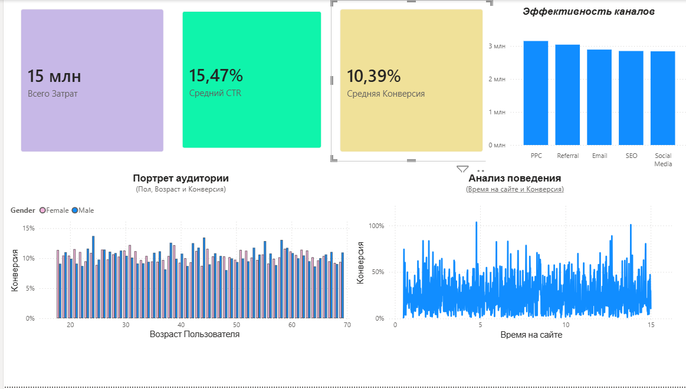

# Анализ эффективности цифрового маркетинга и поведения пользователей

## 🎯 Бизнес-задача
Цель проекта — провести комплексный анализ данных маркетинговых кампаний (3 000 строк), выявить наиболее эффективные каналы привлечения клиентов, составить портрет целевой аудитории по демографическим признакам и проанализировать веб-метрики вовлеченности пользователей на сайте для оптимизации рекламного бюджета.

## 🛠️ Используемый стек
*   **СУБД:** MySQL (phpMyAdmin) — очистка данных, переименование столбцов, агрегация и аналитические запросы.
*   **BI-платформа:** Power BI Desktop — построение интерактивного дашборда и визуализация ключевых KPI.
*   **Разметка:** Markdown (GitHub) — документирование хода исследования.

---

## 📊 Ход исследования и SQL-запросы

### 1. Анализ эффективности рекламных каналов
Запрос группирует данные по источникам трафика и рассчитывает общие инвестиции, среднюю кликабельность (CTR) и итоговую конверсию:

```sql
SELECT 
    Campaign_Channel AS `Рекламный канал`,
    ROUND(SUM(Ad_Spend), 2) AS `Всего затрат ($)`,
    ROUND(AVG(Click_Through_Rate) * 100, 2) AS `Средний CTR (%)`,
    ROUND(AVG(Conversion_Rate) * 100, 2) AS `Средняя Конверсия (%)`
FROM 
    marketing
GROUP BY 
    Campaign_Channel
ORDER BY 
    `Всего затрат ($)` DESC;
```

**Результат выполнения:**

| Рекламный канал | Всего затрат ($) | Средний CTR (%) | Средняя Конверсия (%) |
|---|---|---|---|
| PPC | 3154736.74 | 15.81 | 9.96 |
| Referral | 3044564.72 | 15.09 | 10.39 |
| Email | 2894772.26 | 15.45 | 10.55 |
| SEO | 2851144.10 | 15.43 | 10.44 |
| Social Media | 2842042.91 | 15.56 | 10.66 |

* **Бизнес-вывод:** Канал PPC (контекстная реклама) лидирует по объёму инвестиций ($3.15 млн) и имеет самую высокую кликабельность (CTR = 15.81%). Однако его конверсия в покупки — самая низкая среди всех каналов (всего 9.96%). Наиболее эффективным с точки зрения конверсии является Social Media (10.66%) при меньших затратах.

### 2. Портрет целевой аудитории (Демография и Доход)
Запрос сегментирует клиентов по полу и возрастным группам для выявления наиболее платящих категорий:

```sql
SELECT 
    Gender AS `Пол`,
    CASE 
        WHEN Age < 30 THEN 'До 30 лет'
        WHEN Age BETWEEN 30 AND 50 THEN '30-50 лет'
        ELSE 'Старше 50 лет'
    END AS `Возрастная группа`,
    COUNT(Customer_ID) AS `Количество клиентов`,
    ROUND(AVG(Income), 2) AS `Средний доход ($)`,
    ROUND(AVG(Conversion_Rate) * 100, 2) AS `Средняя Конверсия (%)`
FROM 
    marketing
GROUP BY 
    `Пол`, `Возрастная группа`
ORDER BY 
    `Средняя Конверсия (%)` DESC;
```

**Результат выполнения:**

| Пол | Возрастная группа | Количество клиентов | Средний доход ($) | Средняя Конверсия (%) |
|---|---|---|---|---|
| Male | До 30 лет | 277 | 83532.21 | 10.56 |
| Female | До 30 лет | 410 | 85693.16 | 10.46 |
| Male | Старше 50 лет | 441 | 79288.55 | 10.45 |
| Male | 30-50 лет | 463 | 84529.73 | 10.36 |
| Female | 30-50 лет | 755 | 84356.24 | 10.34 |
| Female | Старше 50 лет | 653 | 87333.65 | 10.33 |

* **Бизнес-вывод:** Самую высокую конверсию в покупку демонстрирует молодая аудитория до 30 лет (мужчины — 10.56%, женщины — 10.46%). При этом молодые женщины (410 человек) проявляют гораздо бóльший интерес к кампаниям, чем молодые мужчины (277 человек), и обладают высоким средним доходом (~$85.7 тыс.). Аудитория женщин старше 50 лет имеет самый высокий доход ($87.3 тыс.), но худшую конверсию (10.33%), что указывает на необходимость доработки ценностного предложения под этот сегмент.

### 3. Анализ поведения пользователей на сайте (Веб-аналитика)
Запрос оценивает влияние глубины просмотра страниц и времени сессии на итоговую конверсию:

```sql
SELECT 
    CASE 
        WHEN Pages_Per_Visit < 4 THEN 'Мало страниц (до 4)'
        WHEN Pages_Per_Visit BETWEEN 4 AND 7 THEN 'Средне страниц (4-7)'
        ELSE 'Много страниц (более 7)'
    END AS `Глубина просмотра`,
    COUNT(Customer_ID) AS `Количество сессий`,
    ROUND(AVG(Time_On_Site), 2) AS `Среднее время на сайте (мин)`,
    ROUND(AVG(Social_Media_Shares), 1) AS `Среднее число репостов`,
    ROUND(AVG(Conversion_Rate) * 100, 2) AS `Средняя Конверсия (%)`
FROM 
    marketing
GROUP BY 
    `Глубина просмотра`
ORDER BY 
    `Средняя Конверсия (%)` DESC;
```

**Результат выполнения:**

| Глубина просмотра | Количество сессий | Среднее время на сайте (мин) | Среднее число репостов | Средняя Конверсия (%) |
|---|---|---|---|---|
| Много страниц (более 7) | 1038 | 7.75 | 24.2 | 10.48 |
| Средне страниц (4-7) | 977 | 7.95 | 25.6 | 10.47 |
| Мало страниц (до 4) | 984 | 7.64 | 25.1 | 10.23 |

* **Бизнес-вывод:** Выявлена прямая продуктовая зависимость: пользователи, вовлеченные в контент сайта (просматривающие более 7 страниц), совершают целевое действие чаще всего (конверсия 10.48%). Быстрый уход с сайта (до 4 страниц и 7.64 мин времени) снижает конверсию до минимальных 10.23%. Рекомендуется внедрить рекомендательные блоки для увеличения глубины просмотра страниц.

---

## 🎨 Визуализация в Power BI (Интерактивный дашборд)
Для топ-менеджмента компании был разработан интерактивный дашборд, который объединяет в себе три направления анализа: верхнеуровневые KPI, эффективность рекламных сплитов и поведенческие тренды клиентов.


